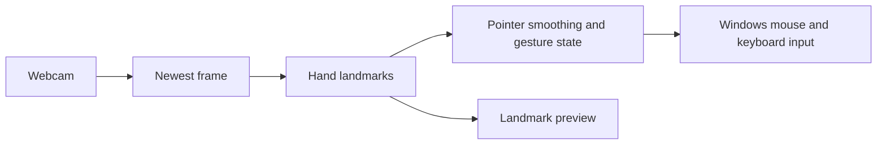

# Hand Gesture Mouse Control — Python & Rust

Control a Windows PC using a webcam and hand gestures. Move the pointer, pinch to click or drag, scroll with your other hand, and open the Windows window picker.

**Status: experimental Windows prototype.** The Python implementation is the behavior reference. The Rust implementation follows the same gesture rules using a separate ONNX tracking pipeline; recognition parity with physical hands is still being evaluated.

## Two implementations

| | Python | Rust |
| --- | --- | --- |
| Tracking | MediaPipe Hand Landmarker | Palm detection + hand landmarks through ONNX Runtime |
| Input | PyAutoGUI | Windows input APIs |
| Camera | OpenCV | Native Media Foundation; optional Python/OpenCV DirectShow fallback |
| Processing | Configurable cap, 20 FPS by default | No processing FPS cap |
| Setup | Python 3.11 or 3.12 | Rust stable MSVC, C++ build tools and Windows SDK |

Actual speed depends on camera mode, hardware and the number of visible hands. A tracker inference benchmark does not measure complete gesture latency. In particular, faster inference cannot raise FPS beyond the camera's frame rate.



## Quick start

Use **Windows 10 or 11**, a webcam, and allow desktop camera access in Windows settings. Clone this repository, then choose an implementation.

### Python

In PowerShell from the repository root:

```powershell
cd Python
py -3.12 -m venv .venv
.\.venv\Scripts\python.exe -m pip install -r requirements.txt
.\.venv\Scripts\python.exe hand_mouse.py
```

The first run downloads the MediaPipe model and verifies its SHA-256. After setup, `Python/run.cmd` launches the app. See the [Python instructions](Python/README.md) and [gesture controls](Python/docs/CONTROLS.md).

### Rust

Install [Rust](https://www.rust-lang.org/tools/install) with the Windows MSVC toolchain and [Visual Studio Build Tools](https://visualstudio.microsoft.com/visual-cpp-build-tools/) with **Desktop development with C++**, including a Windows SDK.

```powershell
cd Rust
cargo run --release -- --tracking-only
```

This first run previews landmarks without sending input. Close the preview, then enable control with:

```powershell
cargo run --release
```

ONNX models are included with attribution. The first build downloads Rust dependencies and ONNX Runtime. If the native camera backend fails, Rust uses `camera_bridge.py` and the adjacent `Python/.venv`; complete the Python dependency setup above to enable that fallback. Tracking and control still run in Rust. See [Rust setup and options](Rust/README.md).

## Controls

The preferred pointer hand is green; the other hand performs the secondary actions when both are visible.

| Gesture or key | Action |
| --- | --- |
| Move pointer hand | Move cursor |
| Thumb + index | Left click; hold to drag |
| Other thumb + pinky | Right click |
| Other thumb + middle | Double click |
| Thumb + ring | Open persistent Windows window picker |
| Other hand V pose, displaced vertically | Continuous scrolling |
| Green thumb + middle | Windows Start |
| Green thumb + pinky | Toggle controls |
| Two-hand triangle, held | Open Chrome profile picker, if Chrome is installed |
| H / Space / Q or Esc | Switch pointer hand / pause / quit |

The [detailed controls](Python/docs/CONTROLS.md) describe gesture precedence and one-hand behavior. Download and open the [visual gesture guide](Python/web/Hand%20Mouse%20Gesture%20Guide.html) locally.

## Behavior and limitations

- Camera frames stay on the PC. Normal operation does not save video. The optional `record_frames.py` tool saves a local comparison clip only when explicitly run.
- Both controllers release held input after 250 ms without a new frame and keep servicing preview controls while waiting for capture.
- Rust owns and terminates its optional capture process on shutdown. A native camera SDK read may remain blocked until the app process exits; shutdown waits at most 500 ms for its worker.
- The hand depth coordinate is inferred relative depth, not a measured distance from the webcam.
- Lighting, occlusion, camera angle and model differences can affect recognition. This is a prototype rather than an accessibility-certified input device.
- Python source dependencies use compatible version ranges; Rust dependencies are locked in `Cargo.lock`. Windows is the supported desktop input platform.

## Development checks

From the repository root:

```powershell
cd Python
python -m unittest discover -s tests -q
cd ../Rust
cargo fmt --all -- --check
cargo clippy --locked --all-targets -- -D warnings
cargo test --locked
cargo build --release --locked
```

The Python behavior tests use simulated input and do not require camera hardware or installed tracking libraries. Rust tests cover gestures, input event sequences, CLI validation, capture polling and capture-process shutdown. Windows CI runs these checks; hardware gesture validation remains an interactive check.

## License and credits

Project source is [MIT licensed](LICENSE). Bundled ONNX models retain their upstream Apache-2.0 license and notices: [model attribution](Rust/MODEL_LICENSE.txt), [model license](Rust/models/LICENSE). The project uses MediaPipe, OpenCV, PyAutoGUI, ONNX Runtime, Nokhwa, minifb and other dependencies under their respective licenses.
